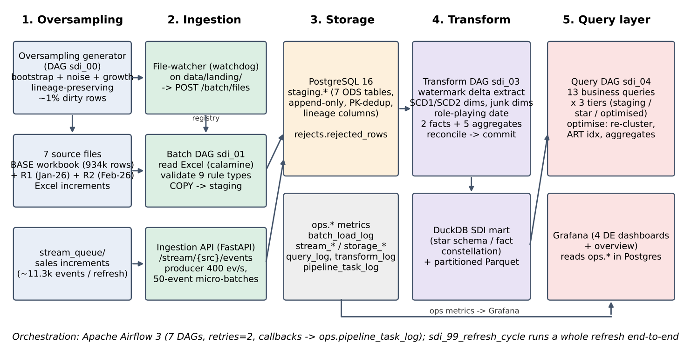
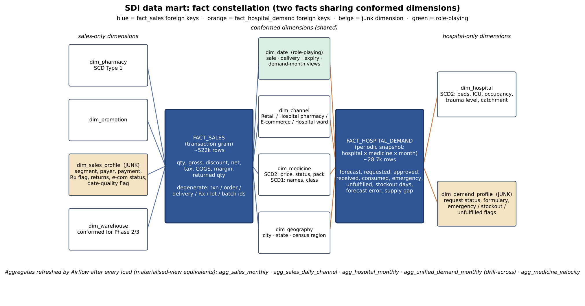

# Pharma SDI — Phase 1: Sales & Demand Intelligence Data Mart

Automated DWH + BI pipeline for a pharmaceutical cold supply chain, orchestrated by **Apache Airflow 3**.
Phase 1 (Milestone 1) is implemented **up to the query layer**: oversampling → batch + streaming ingestion
(API + file-watcher) → PostgreSQL staging (ODS) → DuckDB star schema (fact constellation) → optimised query layer,
observed through **4 Grafana data-engineering dashboards** (+ an overview).

## Group members

| # | Name | ERP |
|---|------|-----|
| 1 | Muhammad Zohair Khan | 33939 |
| 2 | Shaheer Ahmed Farooqui | 19722 |

## The problem we solve

**Planners cannot see true medicine demand, so hospitals are under-supplied and production is planned on incomplete
signals.** Demand arrives through three disconnected systems at different grains: pharmacy POS (transactions),
e-commerce (orders) and hospital ERP exports (hospital × medicine × month). In the 2023–2025 history:

* hospitals requested **6.22 M** packs but received **5.77 M** → a **7.3 % supply gap** (456 k packs)
* forecasts under-shoot consumption in **all 7 disease categories** (bias −1.05 %)
* **117,758** packs were emergency requests (11 % of hospital-months)
* Pain & Inflammatory carries **40 %** of stock-out days; one hospital carries **43 %** of unfulfilled demand

The SDI mart unifies the three demand streams on conformed dimensions (medicine, date, geography, channel) and answers
13 business questions (forecast accuracy, supply-gap funnel, unfulfilled/emergency hotspots, channel revenue & margin,
growth, medicine velocity incl. cold-chain items, unified demand by region, promotions, e-commerce fulfilment, SCD2
price-change impact).

## Submission items → where they are

| Requirement | Location |
|---|---|
| 1. Phase.1.Report (PDF, ≤ 5 pages) | `docs/Phase.1.Report.pdf` |
| 2. SDI.Excel (complete) | `docs/SDI.Excel.xlsx` (26 sheets) |
| 3. Demo video (≤ 5 min) | [Google Drive folder](https://drive.google.com/drive/folders/1264p06CBMcvZOJBQY-h6htO9d8-MXxNf?usp=sharing) — script below |
| 4. All code (Airflow etc.) | `dags/`, `sdi/`, `sql/`, `scripts/`, `grafana/`, `docker-compose.yml` |
| 5. Group member information | table above + `SDI.Excel` sheet `00_Cover` |
| Oversampling report (1–2 pages, 2 %) | `docs/Oversampling.Report.pdf` |

## Architecture



| Layer | Tech | Code | DAG |
|---|---|---|---|
| Oversampling | pandas / numpy | `sdi/generator/oversample.py` | `sdi_00_data_generator` |
| Batch ingestion | watchdog + FastAPI + Airflow | `sdi/ingestion/{watcher,api,batch_loader,validation}.py` | `sdi_01_batch_ingestion` |
| Stream ingestion | FastAPI + producer | `sdi/ingestion/{stream_producer,api}.py` | `sdi_02_stream_ingestion` |
| Storage / staging | PostgreSQL 16 | `sql/postgres/*.sql`, `sdi/ingestion/staging_ddl.py` | `sdi_05_storage_metrics` |
| Transform & model | DuckDB | `sql/duckdb/01_star_schema.sql`, `sdi/warehouse/transform.py` | `sdi_03_transform` |
| Query layer | DuckDB + Postgres | `sdi/query/{catalog,runner}.py` | `sdi_04_query_layer` |
| One-click refresh | Airflow | `dags/sdi_99_refresh_cycle.py` | `sdi_99_refresh_cycle` |
| DE dashboards | Grafana 11 | `grafana/` (provisioned) | – |



## Quick start (Docker)

```bash
# 1. put the provided data in data/source/ (not committed: files exceed GitHub's 100 MB limit)
#    BASE_Pharma_Supply_Chain_Source_Data.xlsx  +  01_master_data.csv ... 07_iot_streaming_data.csv
#    (see data/source/README.md for exact names)
# 2. start everything
cp .env.example .env
docker compose up -d --build
```

| Service | URL |
|---|---|
| Airflow UI | http://localhost:8080 (local demo: every user is admin) |
| Grafana | http://localhost:3000 (anonymous viewer, admin/admin) → folder *SDI Phase 1 - Data Engineering* |
| Ingestion API (Swagger) | http://localhost:8000/docs |
| Postgres | localhost:5432 `pharma_sdi` (postgres/postgres) |

Then in Airflow trigger **`sdi_99_refresh_cycle`** three times with `refresh_tag` = `BASE`, then `R1`, then `R2`
(or drop the generated files in `data/landing/` yourself — the file-watcher picks them up).

> **Clean slate:** `docker compose down -v` only removes the Postgres volume. `./data` is a bind mount, so the DuckDB
> mart, Parquet lake and archived files survive it. After `docker compose down -v` and `docker compose up -d --build`,
> also run `docker compose exec airflow python /opt/sdi/scripts/reset_environment.py --yes` before triggering BASE.

### Without Docker (what we used to test)

```bash
pip install -r requirements.txt
export SDI_PG_DSN="host=localhost dbname=pharma_sdi user=postgres password=postgres"
python -m sdi.ingestion.staging_ddl                    # schemas
uvicorn sdi.ingestion.api:app --port 8000 &            # ingestion API
python -m sdi.ingestion.watcher &                      # file-watcher
export AIRFLOW__CORE__DAGS_FOLDER=$PWD/dags SDI_PROJECT_ROOT=$PWD
scripts/run_cycle_with_airflow.sh BASE                 # runs every DAG with `airflow dags test`
scripts/run_cycle_with_airflow.sh R1
scripts/run_cycle_with_airflow.sh R2
python scripts/build_grafana_dashboards.py             # regenerate dashboard JSON
python scripts/make_figures.py && python scripts/build_sdi_excel.py && python scripts/build_reports.py
```

### Final documents (screenshots + group names)

1. Put the group in `docs/group_members.csv` (`name,student_id`).
2. Save Grafana screenshots over `docs/figures/dash_batch.png`, `dash_stream.png`, `dash_storage.png`, `dash_query.png`
   (the report detects real screenshots, captions them as such and scales them to keep 5 pages).
3. Rebuild inside the running stack:
   `docker compose exec airflow bash -c "cd /opt/sdi && python scripts/build_sdi_excel.py && python scripts/build_reports.py"`
   (do NOT run `make_figures.py` afterwards - it would overwrite the screenshots with preview renders).

`python scripts/reset_environment.py --yes` wipes staging/ops/mart for a clean demo.

## Results of our run (BASE + R1 + R2)

Clean run on the Docker stack (`docker compose down -v` + reset, then `sdi_99_refresh_cycle` BASE → R1 → R2):
every DAG run succeeded, including the watcher-triggered and scheduled ones, with no failed or retried tasks.

| | BASE | R1 (Jan-2026) | R2 (Feb-2026) |
|---|---|---|---|
| Batch rows loaded / rejected | 934,448 / 0 | 14,239 / 23 | 13,023 / 22 |
| Streamed sales events (malformed) | – | 11,221 (97) | 11,257 (98) |
| fact_sales rows | 500,000 | 511,221 | 522,478 |
| Reconciliation staging = mart | ✅ | ✅ | ✅ |

* Streaming: ~396 events/s, avg end-to-end latency ~82 ms (p95 ~123 ms)
* Query layer: Postgres staging ~291.6 ms avg → star schema ~8.2 ms → optimised star ~2.7 ms (≈ 108× faster)
* Storage: sales take 357 MB in the Postgres row store vs 26 MB in the DuckDB columnar fact (≈ 14×)
* SCD: 5 medicine price versions, 1 Type-1 rename, 2 new medicines, HOSP003 bed expansion (2 versions)

## Key design decisions

* **Idempotent everywhere** — PK-protected staging (`ON CONFLICT DO NOTHING`), anti-join fact loads, watermark committed
  only after reconciliation → any task can be re-run.
* **Quality gates fail the DAG** — staging = mart reconciliation, cross-tier result equivalence of every business query,
  no missing month in date coverage.
* **Safe under concurrency** — the watcher-driven chain and the orchestrator can overlap. Every task that opens DuckDB
  takes a cross-process mart lock (tasks wait, never collide); `ops.mart_state` is LOADING between extract and
  reconcile, and the query benchmark only runs on a READY mart. The staging tier reads the committed-snapshot views
  `staging.c_stg_*` (rows up to the committed watermark), so all query tiers describe the same data even mid-stream.
* **Data-quality findings handled explicitly** (SDI.Excel `05_Data_Quality`): Excel timestamps are UTC+05:00 (converted
  to UTC); 22 % of sales are year-start bulk postings (flagged in a junk dimension, excluded from trend KPIs); GS1 ids
  kept as text; "Hospital" channel derived from pharmacy type.
* **Grafana reads only the `ops` schema** in Postgres; dashboards are version-controlled JSON (`scripts/build_grafana_dashboards.py`).

## Demo video script (≤ 5 min)

1. **0:00–0:30 Problem** — one slide: the supply gap / under-forecast evidence (SDI.Excel `01_Problem_KPIs`).
2. **0:30–1:00 Architecture** — `docs/figures/architecture.png`, Airflow DAG list (7 DAGs).
3. **1:00–1:45 BASE state** — Grafana: Batch (sales sheet is the slow one), Storage (row vs column store), Query (~108× speed-up).
4. **1:45–3:15 Live refresh R1** — trigger `sdi_99_refresh_cycle` (R1); show the watcher log registering files, Airflow
   graph progressing, Streaming dashboard throughput line filling in, rejected rows appearing, Storage row counts growing.
5. **3:15–4:15 Refresh R2** — trigger again; show SCD2 in DuckDB (`dim_medicine` versions, HOSP003), Query dashboard
   per-refresh bars staying flat, reconciliation PASS in the Overview transform log.
6. **4:15–5:00 Wrap-up** — what Phase 2/3 reuse (conformed dims, bus matrix sheet `07_Bus_Matrix`).

## Repository layout

```
dags/                Airflow DAGs (one per layer + orchestrator) and shared defaults/callbacks
sdi/                 Python package: config, sources registry, generator, ingestion, warehouse, query, monitoring
sql/postgres         ops / rejects schemas + generated staging DDL
sql/duckdb           star schema DDL (dims, facts, role-playing views)
grafana/             provisioning (datasource, dashboard provider) + 5 dashboard JSON files
scripts/             reset, run cycle, build dashboards / figures / SDI.Excel / reports
docs/                Phase.1.Report.pdf, Oversampling.Report.pdf, SDI.Excel.xlsx, figures/
data/                source/ (you add), landing/, archive/, stream_queue/, generated/, mart/ (all git-ignored)
```
